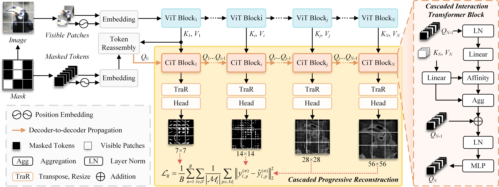

# CasperMIM



This repository is for the official PyTorch implementation of the paper **Masked Image Modeling With Cascaded Progressive Reconstruction**, published in **IEEE Transactions on Multimedia (TMM), 2026**.

[Paper](https://doi.org/10.1109/TMM.2026.3741619)

The code will be released soon.


## Citation

If you find our work useful in your research, please consider citing:

```bibtex
@article{wang2026caspermim,
  title={Masked Image Modeling With Cascaded Progressive Reconstruction},
  author={Wang, Bingying and Zhang, Yuan and Hu, Kai and Gao, Xieping},
  journal={IEEE Transactions on Multimedia},
  volume={28},
  pages={17566--17576},
  year={2026},
  doi={10.1109/TMM.2026.3741619}
}
```
